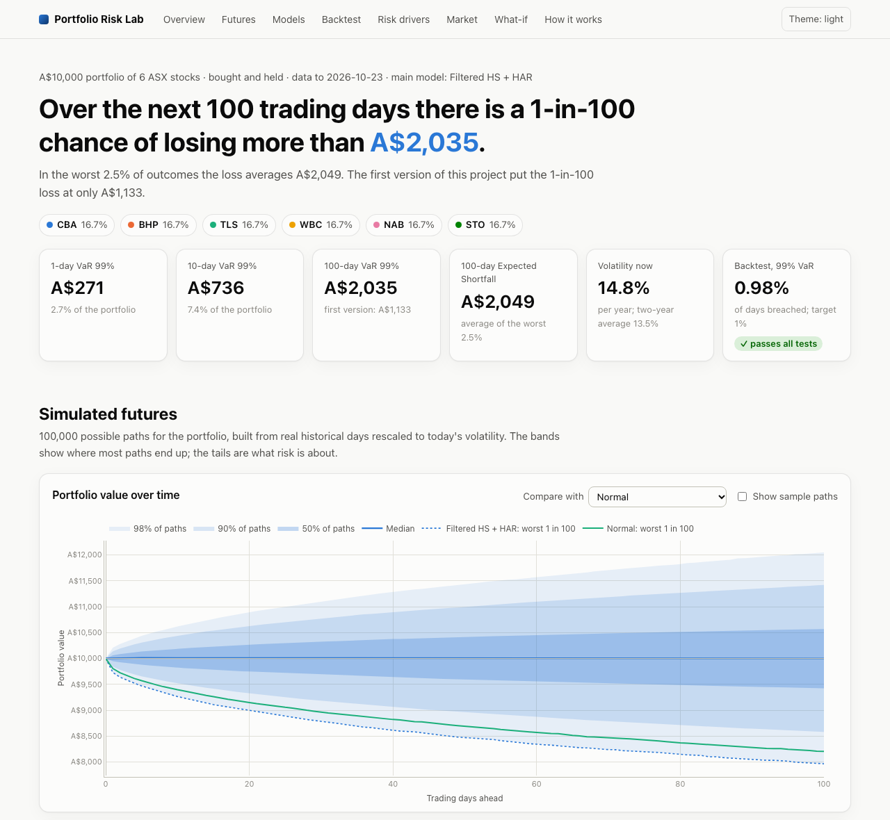
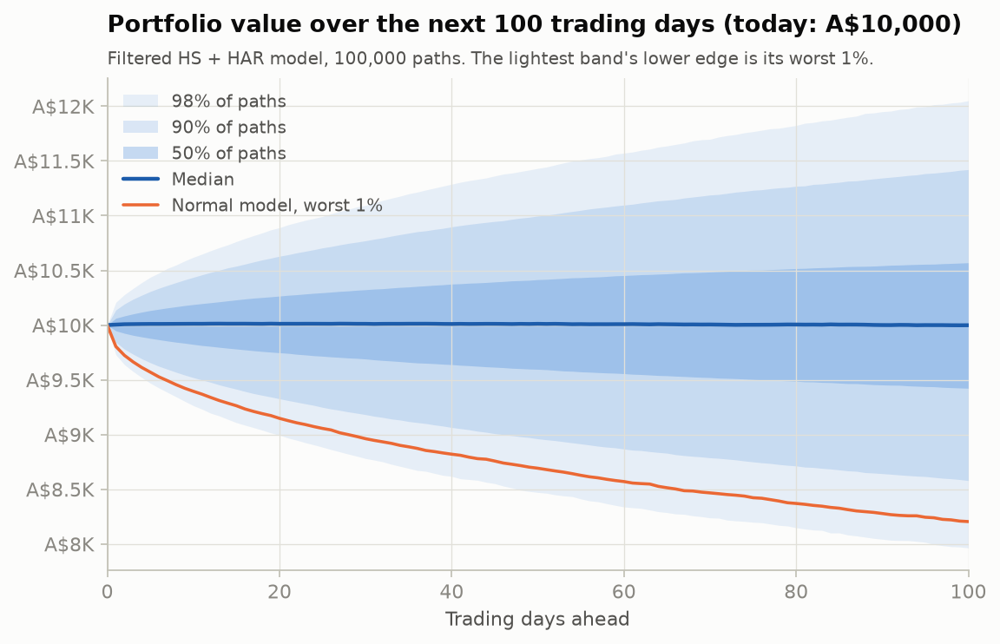
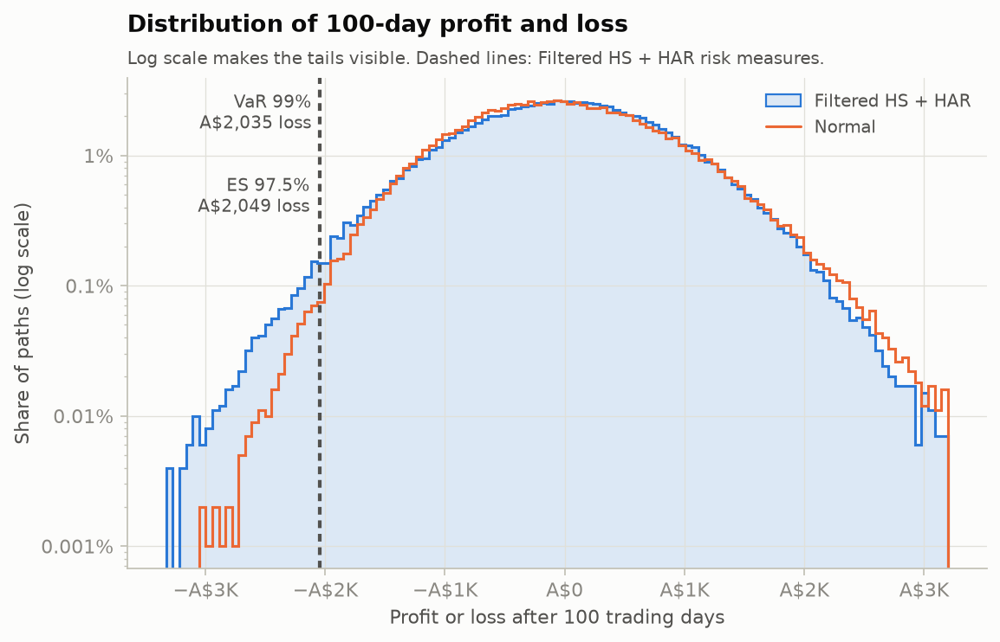
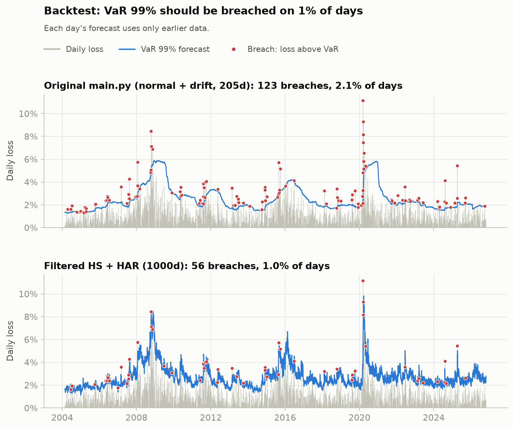
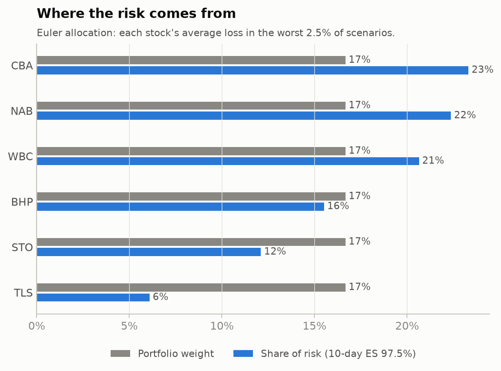
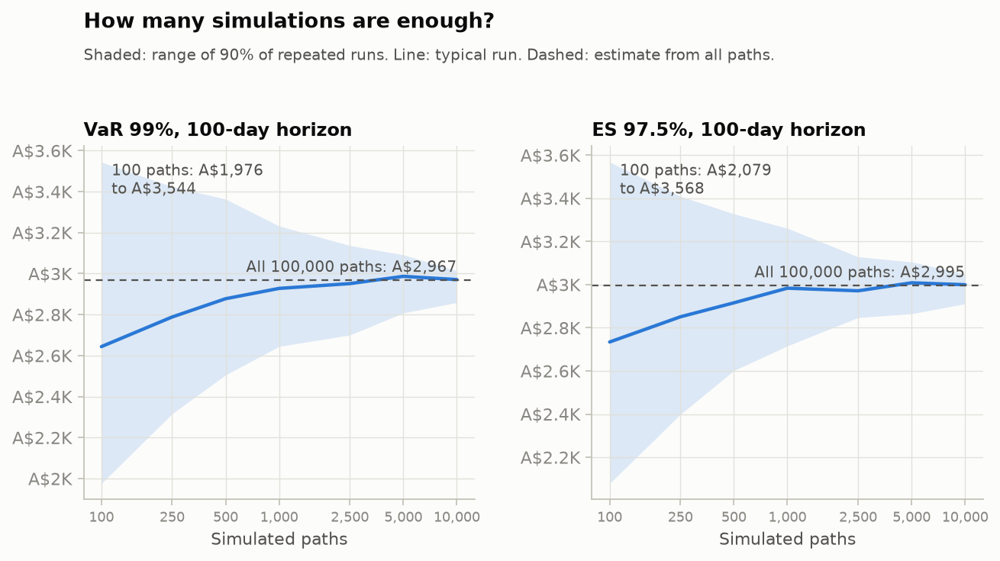

# Monte Carlo portfolio risk: VaR and Expected Shortfall for ASX stocks

How much could an A$10,000 equal-weight portfolio of six ASX stocks (CBA, BHP, TLS, WBC, NAB,
STO) lose over the next 1, 10 or 100 trading days? This project answers with Monte Carlo
simulation under several return models, then tests the models against 20+ years of real losses.

All numbers below come from `python main.py` on data up to 23 Oct 2026 (seed 42). The full
output is in [results/report.txt](results/report.txt).

## Interactive dashboard

```bash
python serve.py          # opens http://127.0.0.1:8000 in your browser
```



A local web page with the whole analysis as interactive charts (hover, zoom, toggle models):
simulated futures, the distribution of outcomes, a model comparison, the 20-year backtest with
zoom-to-crisis buttons, risk contributions, stress tests and market context. It also has a
**what-if simulator**: change the weights, horizon or portfolio value and the server runs a
fresh simulation (about 2 seconds for 25,000 paths over 100 days). A scenario can be shared as a link, for example
`http://127.0.0.1:8000/?weights=CBA:40,BHP:20,TLS:10,WBC:10,NAB:10,STO:10&horizon=20`. There
are light and dark themes. The server listens only on your own computer, and the charts load
Plotly from a CDN, so the page needs an internet connection.

## Key results

**100-day risk, A$ loss** (Monte Carlo standard error A$4–15)

| Model | VaR 95% | VaR 99% | ES 97.5% |
|---|---:|---:|---:|
| First version's assumptions (normal, drift from 205 days) | 623 | 1,133 | 1,138 |
| Normal (500-day covariance, no drift) | 1,323 | 1,795 | 1,807 |
| Student-t (ν = 4.8, fitted) | 1,325 | 1,804 | 1,815 |
| Filtered historical simulation + GJR-GARCH | 1,494 | 2,221 | 2,246 |
| **Filtered historical simulation + HAR** (main model) | **1,421** | **2,035** | **2,049** |

- **The first version understated the risk by about 45%** (A$1,133 vs A$2,035). Most of the gap
  is its drift: +14.7% a year, estimated from 205 days and statistically indistinguishable
  from zero. Removing it alone moves the 100-day VaR 99% from A$1,133 to A$1,777.
- **100 simulations are far too few.** With 100 paths, the 100-day VaR 99% lands anywhere from
  A$1,440 to A$2,363 (90% of runs). With 100,000 paths it is A$2,035 ± 9.
- **The main model passes every backtest test**, including the test for clustered breaches,
  which GARCH fails. It is also the only model that stays accurate at 99% in each of three
  market regimes (GFC, 2010s, COVID era).
- **Better volatility measurement is what made the difference.** HAR measures each day's
  volatility from its open, high, low and close rather than the close alone, and forecasts it
  from the past day, week and month at once.





### Backtest: 1-day VaR, re-fitted daily on past data only, Feb 2004 – Oct 2026 (5,735 days)

| Model | 95% breaches (target 5%) | 99% breaches (target 1%) | Kupiec p (99%) | Clustering p | Worst 250 days | ES ratio (target 1) |
|---|---:|---:|---:|---:|---|---:|
| First version (normal + drift) | 5.68% | 2.14% | 0.000 | 0.000 | 18 (red) | 1.17 |
| Normal, 500 days | 5.27% | 1.99% | 0.000 | 0.000 | 18 (red) | 1.23 |
| Student-t, 500 days | 5.70% | 1.57% | 0.000 | 0.000 | 15 (red) | 1.10 |
| Historical simulation, 500 days | 5.61% | 1.45% | 0.001 | 0.000 | 13 (red) | 1.07 |
| Filtered HS + EWMA | 4.50% | 0.99% | 0.963 | 0.000 | 9 (yellow) | 1.00 |
| Filtered HS + GJR-GARCH | 4.71% | 1.01% | 0.931 | 0.003 | 9 (yellow) | 1.01 |
| **Filtered HS + HAR** | **4.45%** | **0.98%** | **0.857** | **0.125** | **7 (yellow)** | **1.00** |

A p-value below 0.05 rejects the model.

- **Clustered breaches.** Breaches on consecutive days fall from 10 for the first version to 6
  with EWMA, 4 with GJR-GARCH and 2 with HAR. A well-calibrated model would have about 0.6 by
  chance. The two that remain are the start of the late-2014 oil collapse and the August 2024
  yen carry-trade unwind.
- **At 95%, HAR passes only just** (p = 0.050), and in the cautious direction: 255 breaches
  against 287 expected.
- **The normal model looks fine at 95%** (5.27% breaches, p = 0.36), which is why its tail
  problem is easy to miss.

**The same backtest within each market regime**, at 99% (✓ = breach rate and clustering
both pass):

| Model | GFC era, 2004–09 | 2010–19 | COVID era, 2020–26 |
|---|---|---|---|
| Filtered HS + EWMA | ✓ | breaches cluster (p = 0.024) | breaches cluster (p < 0.001) |
| Filtered HS + GJR-GARCH | too many breaches (1.55%, p = 0.049) | ✓ | breaches cluster (p = 0.002) |
| **Filtered HS + HAR** | ✓ | ✓ | ✓ |



### Other findings

- **Volatility today:** HAR sees the banks as calmer than GARCH does (CBA 22% a year vs 29%),
  because their recent daily price ranges have been modest. A close-to-close model only sees
  a few large closing moves.
- **Where the risk comes from:** the three banks hold 50% of the money and cause 59% of the
  10-day Expected Shortfall; Telstra holds 17% and causes 6%. Long-only minimum-variance
  weights (58% Telstra) would cut 10-day ES from A$742 to A$614.
- **Path risk:** there is a 21.8% chance of being down 10% at some point within 100 days, but
  only 12.2% of being down 10% on day 100. A single end-date VaR hides this.
- **Options:** a 100-day put struck at 95% (model fair premium A$150) cuts the 100-day VaR 99%
  from A$2,035 to A$650. Simulation handles the put's kinked payoff; a closed-form normal VaR
  cannot.
- **Stress tests (today's weights):** Lehman collapse to the March 2009 low: −26.0%. COVID
  crash, 20 Feb – 23 Mar 2020: −40.0%. That is far beyond the model's 100-day ES (20%), a
  reminder that ES is an average of bad outcomes, not the worst case.





## Method

**Data.** Daily dividend-adjusted open, high, low and close from Yahoo Finance, January 2000 to
October 2026. Days on which any stock is missing are dropped, as are holiday rows where Yahoo
repeats every price. Data before 2000 is left out because Yahoo's 1997–98 ASX prices are mostly
stale. 24 opening prices are bad prints, for example CBA opening at A$1.84 the day after
closing at A$13.62 and then closing unchanged. Any overnight gap above 8% that is also more
than 3x the day's close-to-close move is treated as bad. Prices are cached in `data/` and the
end date is fixed, so results are reproducible.

**Portfolio.** Bought today and held, with no rebalancing. Weights are matched to stocks by
ticker, never by position.

**Models.** All of them set the expected return to zero: a two-year sample cannot estimate it,
and a positive drift shrinks the risk numbers. Each log return has mean −σ²/2, so the expected
*simple* return is exactly zero.

- *Normal:* multivariate normal log returns, sample covariance of the last 500 days.
- *Student-t:* multivariate t with the same covariance and degrees of freedom fitted by maximum
  likelihood. A shared shock each day makes the stocks crash together (tail dependence).
- *Filtered historical simulation* (Barone-Adesi et al., 1999): each stock's returns are divided
  by its forecast volatility to get standardised shocks. Paths are built from randomly drawn
  historical *days* of these shocks (the last 1,000 days), which keeps the real joint moves and
  fat tails, rescaled to the current volatility. Volatility then updates along each path.
  Three volatility models are compared:
  - *EWMA* (RiskMetrics, λ = 0.94): nothing to estimate, no long-run level.
  - *GJR-GARCH(1,1)*: one decay rate, plus a leverage term so that falls raise volatility more
    than rises. Fitted per stock by quasi-maximum likelihood with variance targeting.
  - *HAR* (Corsi, 2009), the main model, fitted per stock by least squares. It works on a
    daily variance measured from prices: the overnight gap squared plus the Garman-Klass
    estimate from the open, high, low and close. It predicts the log of that variance from
    its average over the past day, week and month, plus recent falls measured against each
    day's own volatility. Measuring falls this way keeps the simulation stable: in raw-return
    units, falls in a turbulent state fed on themselves and 0.1% of paths exploded. In a
    simulation, each drawn historical day supplies both its return shock and its volatility
    surprise, so the two stay linked as they really were.

The main model was chosen by the backtest. Choosing a model by its backtest slightly
flatters it, so the other models are reported alongside.

**Risk measures.** VaR is the loss exceeded with the given probability. Expected Shortfall
(ES) is the average loss beyond it; ES 97.5% is the Basel FRTB standard. Monte Carlo standard
errors come from 20 independent batches. A closed-form lognormal formula checks the normal
simulation (A$196 vs A$195 for the 1-day VaR 99%). Bootstrapping the estimation window shows
parameter risk: the 1-day normal VaR 99% ranges from A$178 to A$214 (90% range).

**Risk decomposition.** Euler allocation: each stock's contribution is its average loss in the
scenarios beyond VaR, and the contributions add up exactly to the portfolio ES.

**Backtest.** Every day from 2004, each model is re-fitted using only earlier data and its
1-day VaR and ES are compared with the realised loss. GARCH, HAR and Student-t parameters are
re-estimated every 20 days on up to 10 years of data; volatilities update daily. The tests are
Kupiec (is the breach rate right?), Christoffersen (do breaches cluster?), the Basel traffic
light (99% breaches per 250 days), and the ratio of realised to forecast loss on breach days.

## Limitations

- **Volatility dynamics change between regimes.** Volatility shocks faded within weeks in
  2010–19 but within days after 2021. Every model's fitted parameters shift with this, and
  HAR's shift less than GARCH's. HAR copes by re-fitting monthly and combining three time
  scales, and the regime backtest shows it stays accurate. Still, a sudden change in market
  behaviour will always take a few weeks to show up in the parameters.
- **All models overstate 95% risk in the calm 2020–26 period** (3.8–4.0% breaches against 5%).
  That is the safe direction, but it is a miss.
- **Two back-to-back breaches remain.** Intraday data (5-minute bars) would measure each day's
  volatility better than the daily high and low. It is not available for free.
- **Only the 1-day forecasts are backtested.** Since 2000 there are only about 68
  non-overlapping 100-day periods, too few to test a 1% tail.
- No transaction costs, liquidity effects or currency risk; dividends are reinvested through
  adjusted prices.
- The minimum-variance weights are fitted on the same data used to evaluate them.
- The put premium is the model's own fair value at a zero interest rate. Market prices
  usually imply higher volatility.

## Usage

```bash
pip install -r requirements.txt
python main.py                                    # report, charts and dashboard data in results/ (~20 s)
python serve.py                                   # interactive dashboard at http://127.0.0.1:8000
python main.py --weights CBA=0.4,BHP=0.2,TLS=0.1,WBC=0.1,NAB=0.1,STO=0.1
python main.py --horizon 10 --paths 50000 --skip-backtest
python main.py --end today --refresh              # latest data instead of the cached snapshot
python main.py --help                             # all options
python -m unittest                                # 27 tests
```

Tested with Python 3.14 and the package versions pinned in `requirements.txt`.

## Project structure

```
main.py                  command-line entry point; builds the report
serve.py                 local web server for the dashboard and what-if simulations
portfolio_risk/
    data.py              download, cache and clean prices; range-based daily variance
    volatility.py        EWMA, GJR-GARCH and HAR volatility models
    models.py            normal, Student-t and filtered historical simulation return models
    simulation.py        Monte Carlo engine (buy-and-hold paths)
    risk.py              VaR, ES, standard errors, Euler allocation, stress tests
    backtest.py          rolling 1-day backtest and its statistical tests
    plots.py             static charts (PNG)
    dashboard.py         turns results into JSON for the dashboard
web/                     the dashboard page (HTML, CSS, JavaScript with Plotly)
tests/                   unit tests
results/                 report and charts from the last run
```
